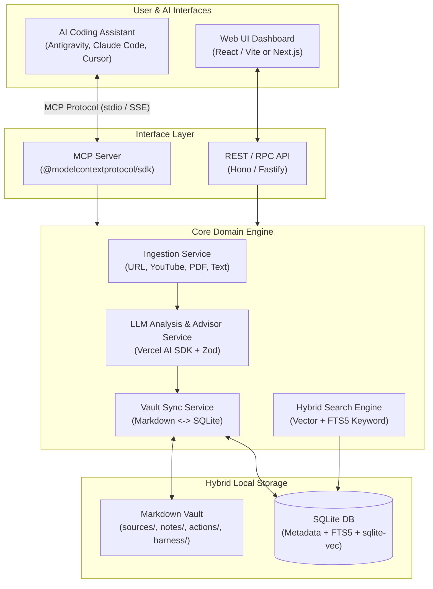

# 01 — Architecture & Storage

## 1. High-Level System Architecture

The application is designed as a **local-first, modular TypeScript system** with a shared core service layer that powers both the **Web UI** (via HTTP API) and the **MCP Server** (via `stdio` or `Streamable HTTP`).



---

## 2. Technology Stack

- **Runtime & Language**: Node.js (>= 20 LTS) + TypeScript (Strict mode)
- **Package Structure**: Single repository (or pnpm workspace) containing:
  - `src/core/`: Shared business logic, storage, ingestion, LLM analysis, and search
  - `src/mcp/`: MCP server entry point (`stdio` and HTTP/SSE transports)
  - `src/server/`: HTTP API server (Hono)
  - `src/web/`: React + Tailwind CSS + shadcn/ui frontend
- **Database & Search**:
  - `better-sqlite3` for fast synchronous local relational queries and **FTS5** full-text search
  - `sqlite-vec` extension for local vector similarity search (cosine distance on embeddings)
  - `drizzle-orm` (optional) or typed SQL queries for schema management and migrations
- **LLM & Embeddings**:
  - **Vercel AI SDK (`ai`)** + `zod` for structured object extraction (`generateObject`) and embeddings (`embed` / `embedMany`)
  - Supports configurable providers via environment variables or UI settings: OpenAI, Anthropic, Google Gemini, or local Ollama/OpenAI-compatible endpoints
- **Ingestion Parsers**:
  - **Web URLs**: `@mozilla/readability` + `jsdom` / `turndown` (or Jina Reader fallback) to extract clean Markdown
  - **YouTube**: `youtube-transcript` (with `yt-dlp` fallback if installed) for video captions + metadata
  - **PDF / Docs**: `unpdf` / `pdf-parse` for PDFs, `mammoth` for `.docx`

---

## 3. Hybrid Storage Model

The storage layer follows a **Markdown-as-Source-of-Truth + SQLite-as-Index** pattern:

1. **Human-Readable Markdown Vault**:
   Every entity (`Source`, `Note`, `ActionPoint`, `HarnessApplication`, and `UserProfile`) is saved as a `.md` file with structured YAML frontmatter (`gray-matter`). This allows the user to open the data folder directly in **Obsidian**, VS Code, or track it with **Git**.
2. **SQLite Relational & Vector Index**:
   SQLite stores all structured metadata, entity relationships, FTS5 full-text indexes, and vector embeddings.
3. **Synchronization**:
   - **Write Path (App/MCP -> Storage)**: When an entity is created or updated via the Web UI or MCP, the `VaultSyncService` writes the Markdown file to disk and immediately upserts the record + embedding into SQLite within a single logical operation.
   - **External Edit Detection (File Watcher / Startup Sync)**: `chokidar` watches the vault directory (or runs a fast content-hash check on startup) so manual edits made by the user in an external editor (like Obsidian) automatically re-index in SQLite.

---

## 4. Vault Directory Structure

By default, data is stored in a configurable directory (e.g., `./vault` or `~/.knowledge-library`):

```text
vault/
├── profile.md                        # User context, workflow & AI harness profile
├── sources/
│   └── 2026-10-18-building-effective-agents.md
├── notes/
│   ├── note-01j9x8a-orchestrator-worker-pattern.md
│   └── note-01j9x8b-prompt-chaining-vs-autonomous.md
├── actions/
│   └── action-01j9x8c-audit-subagent-prompts.md
├── harness/
│   └── harness-01j9x8d-create-verification-skill.md
└── .index/
    └── library.sqlite                # Reconstructible SQLite + FTS5 + Vector DB
```

Because `.index/library.sqlite` is derived from the Markdown files in `vault/`, the entire database index can be rebuilt at any time with a `rebuild-index` command.
