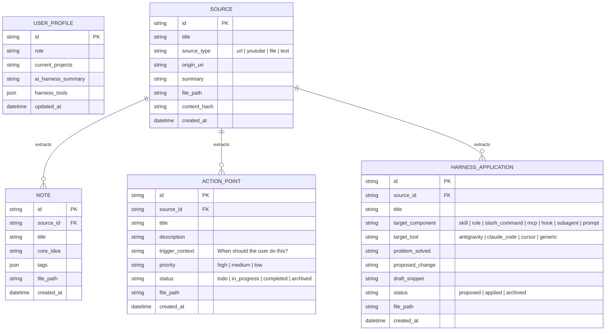

# 02 — Data Models & Schemas

## 1. Entity Relationship Overview



---

## 2. Entity Specifications & Markdown Formats

### 2.1 User & Harness Profile (`vault/profile.md`)
Provides personal context injected into LLM prompts during **source analysis** and **MCP workflow advisory**.

```markdown
---
id: default-profile
role: "Senior Full-Stack & AI Engineer"
primary_tools:
  - antigravity
  - claude-code
  - cursor
updated_at: "2026-10-18T16:00:00Z"
---

## Current Focus & Projects
- Building TypeScript + React applications and AI agent workflows.
- Focused on improving autonomous coding reliability and test verification.

## My Current AI Harness Setup
- **Agents**: Antigravity CLI & Claude Code
- **Customizations Used**:
  - `.agents/rules/` for project conventions
  - `SKILL.md` skills for specialized workflows
  - Custom MCP servers for local tools
- **Pain Points**:
  - Context bloat in long sessions
  - Agents skipping verification steps or making assumptions without asking
```

---

### 2.2 Source (`vault/sources/<slug>.md`)
Stores the ingested raw material, metadata, and high-level executive summary.

```markdown
---
id: src_01j9x800
title: "Building Effective Agents"
source_type: "url" # "url" | "youtube" | "file" | "text"
origin_uri: "https://www.anthropic.com/research/building-effective-agents"
author: "Anthropic Research"
tags: ["agents", "workflows", "orchestration"]
extracted_notes: ["note_01j9x8a", "note_01j9x8b"]
extracted_actions: ["act_01j9x8c"]
extracted_harness: ["hrn_01j9x8d"]
created_at: "2026-10-18T16:05:00Z"
---

## Executive Summary
Concise 3-5 sentence overview of the source content and why it matters.

## Raw / Cleaned Content
Full extracted Markdown content or transcript of the source...
```

---

### 2.3 Note / Main Idea (`vault/notes/<id>-<slug>.md`)
Represents a single atomic concept, mental model, or principle extracted from a source.

```markdown
---
id: note_01j9x8a
source_id: src_01j9x800
title: "Prefer Composable Workflows Over Autonomous Loops When Path Is Predictable"
tags: ["architecture", "agent-design", "prompt-chaining"]
status: "active" # "active" | "archived"
created_at: "2026-10-18T16:05:10Z"
---

## Core Idea
When a task can be decomposed into fixed, predictable subtasks, a deterministic prompt chain or orchestrator-worker workflow outperforms an open-ended autonomous agent in cost, latency, and reliability.

## Supporting Details & Quotes
- Autonomous agents trade higher latency and token cost for flexibility on ambiguous tasks.
- Gate checks between chained steps catch errors early before they compound.

## When to Apply
When designing multi-step LLM features or deciding whether to spawn an autonomous subagent vs. a structured skill/script.
```

---

### 2.4 Action Point (`vault/actions/<id>-<slug>.md`)
Concrete action or habit the user should execute based on the source knowledge.

```markdown
---
id: act_01j9x8c
source_id: src_01j9x800
related_note_ids: ["note_01j9x8a"]
title: "Audit tool definitions in MCP servers for poka-yoke (error-proofing)"
priority: "high" # "high" | "medium" | "low"
status: "todo" # "todo" | "in_progress" | "completed" | "archived"
trigger_context: "When defining or refactoring MCP tool schemas or agent tools"
created_at: "2026-10-18T16:05:10Z"
completed_at: null
---

## What to Do
Review existing tool parameter descriptions and enforce strict requirements (e.g., requiring absolute file paths instead of relative paths, using explicit enums, and providing examples in descriptions).

## Why (Expected Impact)
Reduces tool invocation errors and wasted agent retries more effectively than tweaking system prompts.
```

---

### 2.5 Harness Application (`vault/harness/<id>-<slug>.md`)
Actionable blueprint for upgrading the user's AI harness (skills, rules, hooks, prompts, subagents, MCP servers) based on the source.

```markdown
---
id: hrn_01j9x8d
source_id: src_01j9x800
related_note_ids: ["note_01j9x8a"]
title: "Add Tool Design Checklist to MCP Builder Skill"
target_component: "skill" # "skill" | "rule" | "slash_command" | "mcp" | "hook" | "subagent" | "prompt"
target_tool: "antigravity" # "antigravity" | "claude_code" | "cursor" | "generic"
status: "proposed" # "proposed" | "applied" | "archived"
trigger_context: "When creating or modifying an MCP server or agent tool definition"
created_at: "2026-10-18T16:05:10Z"
applied_at: null
---

## Problem Solved
Agents frequently misuse tools when parameter semantics are implicit (e.g., relative vs. absolute paths, ambiguous IDs).

## Proposed Harness Integration
Create or update a rule/skill in `.agents/rules/tool-design.md` (or custom skill) that enforces poka-yoke principles whenever the AI writes a new tool or MCP endpoint.

## Draft Implementation / Snippet
```markdown
# Rule: Agent Ergonomics (Poka-Yoke) for Tool Definitions
When designing MCP tools or function schemas:
1. Require absolute paths (`AbsolutePath`) rather than relative paths.
2. Replace free-form strings with explicit `enum` values wherever the domain is bounded.
3. Include concrete usage examples and edge-case warnings in the parameter `description`.
```
```

---

## 3. SQLite Database Schema

SQLite mirrors the Markdown files and maintains both FTS5 virtual tables and `sqlite-vec` vector tables:

```sql
CREATE TABLE sources (
  id TEXT PRIMARY KEY,
  title TEXT NOT NULL,
  source_type TEXT NOT NULL,
  origin_uri TEXT,
  summary TEXT NOT NULL,
  raw_content TEXT NOT NULL,
  tags_json TEXT NOT NULL DEFAULT '[]',
  file_path TEXT NOT NULL UNIQUE,
  content_hash TEXT NOT NULL,
  created_at TEXT NOT NULL
);

CREATE TABLE notes (
  id TEXT PRIMARY KEY,
  source_id TEXT NOT NULL REFERENCES sources(id) ON DELETE CASCADE,
  title TEXT NOT NULL,
  core_idea TEXT NOT NULL,
  details TEXT NOT NULL,
  when_to_apply TEXT,
  tags_json TEXT NOT NULL DEFAULT '[]',
  status TEXT NOT NULL DEFAULT 'active',
  file_path TEXT NOT NULL UNIQUE,
  content_hash TEXT NOT NULL,
  created_at TEXT NOT NULL
);

CREATE TABLE action_points (
  id TEXT PRIMARY KEY,
  source_id TEXT NOT NULL REFERENCES sources(id) ON DELETE CASCADE,
  title TEXT NOT NULL,
  what_to_do TEXT NOT NULL,
  why_impact TEXT,
  trigger_context TEXT NOT NULL,
  priority TEXT NOT NULL DEFAULT 'medium',
  status TEXT NOT NULL DEFAULT 'todo',
  related_note_ids_json TEXT NOT NULL DEFAULT '[]',
  file_path TEXT NOT NULL UNIQUE,
  content_hash TEXT NOT NULL,
  created_at TEXT NOT NULL,
  completed_at TEXT
);

CREATE TABLE harness_applications (
  id TEXT PRIMARY KEY,
  source_id TEXT NOT NULL REFERENCES sources(id) ON DELETE CASCADE,
  title TEXT NOT NULL,
  target_component TEXT NOT NULL,
  target_tool TEXT NOT NULL DEFAULT 'generic',
  problem_solved TEXT NOT NULL,
  proposed_change TEXT NOT NULL,
  draft_snippet TEXT,
  trigger_context TEXT NOT NULL,
  status TEXT NOT NULL DEFAULT 'proposed',
  related_note_ids_json TEXT NOT NULL DEFAULT '[]',
  file_path TEXT NOT NULL UNIQUE,
  content_hash TEXT NOT NULL,
  created_at TEXT NOT NULL,
  applied_at TEXT
);

-- Unified Full-Text Search (FTS5) across Notes, Actions, and Harness Apps
CREATE VIRTUAL TABLE knowledge_fts USING fts5(
  entity_id UNINDEXED,
  entity_type UNINDEXED, -- 'note' | 'action' | 'harness' | 'source'
  title,
  body,
  trigger_context,
  tags
);

-- Vector Embeddings Table (sqlite-vec)
CREATE VIRTUAL TABLE knowledge_vec USING vec0(
  entity_id TEXT PRIMARY KEY,
  entity_type TEXT,
  embedding FLOAT[1536] -- Dimension configurable based on embedding model
);
```
