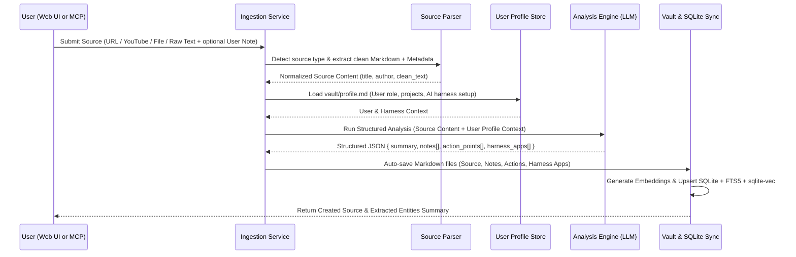

# 03 — Ingestion & Analysis Pipeline

## 1. End-to-End Ingestion Flow



---

## 2. Source Parsers & Extractors

The `IngestionService` normalizes any input into a standard `NormalizedSourceInput` object before analysis:

| Source Type | Detection / Input | Extraction Mechanism | Fallback |
| :--- | :--- | :--- | :--- |
| **YouTube Video** | `youtube.com/watch?v=...` or `youtu.be/...` | Fetch video title/channel via oEmbed + extract captions via `youtube-transcript` with timestamps grouped into logical paragraphs. | `yt-dlp --write-auto-sub` if installed locally, or prompt user for transcript. |
| **Web URL / Article** | `http://` or `https://` (non-YouTube) | Fetch HTML -> parse main article DOM with `@mozilla/readability` -> convert HTML to clean Markdown via `turndown`. | Fetch via `https://r.jina.ai/<url>` if local fetch is blocked or JS-rendered. |
| **Local File** | File upload (Web UI) or local file path (MCP) | - `.md`, `.txt`: Read UTF-8 directly<br>- `.pdf`: Extract text via `unpdf`<br>- `.docx`: Extract Markdown via `mammoth` | Reject unsupported binary files with clear error. |
| **Raw Text / Note** | Direct string payload | Use directly; auto-generate title during LLM analysis if not provided. | N/A |

### Deduplication
Before running expensive LLM analysis, the service checks if a `Source` with the same normalized `origin_uri` or `content_hash` already exists:
- If found, the user/caller can either return the existing analysis or pass `forceReanalyze: true` to re-run extraction.

---

## 3. LLM Analysis Engine

### 3.1 Context-Aware System Prompt
The analyzer is instructed not merely to summarize, but to act as a **Personal Knowledge Distiller & AI Systems Architect**:

1. **Inject `vault/profile.md`**: The prompt includes the user's current role, active projects, and AI harness setup (e.g., Antigravity, Claude Code, Cursor, skills, rules, MCPs).
2. **Optional User Intent**: When submitting a source, the user can optionally pass a `focus_prompt` (e.g., *"Focus on how they structure subagent verification"*).
3. **Three-Pillar Extraction Rules**:
   - **Notes (Main Ideas)**: Must be atomic, evergreen concepts that stand on their own outside the source. Include *when to apply* each idea.
   - **Action Points**: Concrete, verifiable actions or workflow habits the user should adopt. Must include a `trigger_context` describing the exact situation where this action applies.
   - **Harness Applications**: Concrete ways to bake the source's wisdom into the user's AI harness so the AI automatically enforces or uses the knowledge in the future. Must classify `target_component` (`skill`, `rule`, `slash_command`, `mcp`, `hook`, `subagent`, `prompt`) and include a ready-to-use `draft_snippet`.

### 3.2 Structured Output Schema (Zod)

```typescript
import { z } from "zod";

export const ExtractionResultSchema = z.object({
  title: z.string().describe("Clean, descriptive title for the source"),
  executive_summary: z.string().describe("3-5 sentence synthesis of the core thesis and value"),
  tags: z.array(z.string()).describe("3-7 lowercase kebab-case topic tags"),

  notes: z.array(
    z.object({
      title: z.string().describe("Atomic, assertion-style title of the main idea"),
      core_idea: z.string().describe("Clear explanation of the concept or mental model"),
      supporting_details: z.string().describe("Key arguments, examples, or quotes from the source"),
      when_to_apply: z.string().describe("Situations or tasks where this concept is relevant"),
      tags: z.array(z.string()),
    })
  ),

  action_points: z.array(
    z.object({
      title: z.string().describe("Imperative action title"),
      what_to_do: z.string().describe("Specific steps the user should take"),
      why_impact: z.string().describe("Expected benefit of taking this action"),
      trigger_context: z.string().describe("Situation/workflow moment when the user should do this"),
      priority: z.enum(["high", "medium", "low"]),
      related_note_indices: z.array(z.number()).describe("0-based indices of related notes from this extraction"),
    })
  ),

  harness_applications: z.array(
    z.object({
      title: z.string().describe("Name of the proposed AI harness improvement"),
      target_component: z.enum([
        "skill",
        "rule",
        "slash_command",
        "mcp",
        "hook",
        "subagent",
        "prompt",
      ]),
      target_tool: z.enum(["antigravity", "claude_code", "cursor", "generic"]),
      problem_solved: z.string().describe("What failure mode or inefficiency this solves in the AI workflow"),
      proposed_change: z.string().describe("How to integrate this into the user's AI harness"),
      trigger_context: z.string().describe("When the AI or user should invoke or apply this harness rule/skill"),
      draft_snippet: z.string().describe("Ready-to-use Markdown/code draft for the rule, SKILL.md, prompt, or hook"),
      related_note_indices: z.array(z.number()),
    })
  ),
});
```

---

## 4. Long-Source Handling

For very long sources (e.g., 2-hour YouTube transcripts or long PDFs exceeding ~40k tokens):
1. **Map-Reduce Extraction**: Split content into semantic chunks (~12k tokens with 500-token overlap), extract candidate notes/insights per chunk, and run a final synthesis pass against the user's profile to deduplicate and produce the final cohesive `ExtractionResultSchema`.
2. **Standard Context Sources (<40k tokens)**: Processed in a single pass using modern long-context models (e.g., Gemini 2.5/4, Claude Sonnet, GPT-4o).

---

## 5. Embedding & Hybrid Search Indexing

Immediately after saving the Markdown files:
1. For each `Note`, `ActionPoint`, and `HarnessApplication`, construct a composite text representation:
   `[Type] Title\nTrigger/When to Apply: ...\nBody: ...\nTags: ...`
2. Generate vector embeddings (or fallback to pure FTS5 BM25 keyword search if no embedding API/model is configured).
3. Hybrid Search combines **Reciprocal Rank Fusion (RRF)** of:
   - Vector cosine similarity (`sqlite-vec`)
   - BM25 full-text search (`knowledge_fts`)
   - Status filtering (e.g., prioritizing `active` notes, `todo`/`in_progress` actions, and `proposed`/`applied` harness apps).
