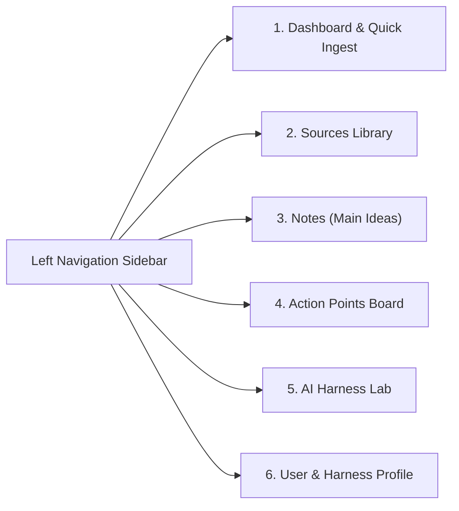

# 05 — Web UI Specification

## 1. Design Philosophy

The Web UI provides a fast, keyboard-friendly browser dashboard for adding sources, exploring extracted insights, tracking action points, and managing AI harness upgrades. Because items are **auto-saved as active** upon ingestion, the UI focuses on immediate visibility, fast filtering, inline editing, and one-click copying/exporting of harness snippets.

---

## 2. Information Architecture & Navigation

---

## 3. Core Screens & Features

### 3.1 Dashboard & Quick Ingest (`/`)
- **Universal Ingest Bar (Top of Page)**:
  - Single input box accepting a **Web URL**, **YouTube URL**, **Raw Text/Markdown**, or **File Drag-and-Drop** (`.pdf`, `.md`, `.txt`, `.docx`).
  - Optional collapsible *"Focus / Context instructions"* field (e.g., *"Extract ideas relevant to our frontend testing setup"*).
  - Live progress indicator showing: `Fetching Source -> Analyzing with Profile -> Auto-saved X Notes, Y Actions, Z Harness Apps`.
- **Recent Extractions Feed**:
  - Cards showing the most recently analyzed sources and their extracted triples (Notes, Actions, Harness Apps).
- **Active Action & Harness Highlights**:
  - Quick-glance widget for high-priority `todo` Action Points and `proposed` Harness Applications.

### 3.2 Sources View (`/sources` & `/sources/:id`)
- **List View**: Filterable by source type (`url`, `youtube`, `file`, `text`), tags, and date.
- **Source Detail View**:
  - Header with title, origin link, tags, and **Re-analyze** button.
  - Executive Summary.
  - Three side-by-side or tabbed columns displaying all extracted **Notes**, **Action Points**, and **Harness Applications** linked to this source.
  - Collapsible viewer for the cleaned raw Markdown/transcript.

### 3.3 Notes / Main Ideas Explorer (`/notes`)
- **Search & Filter**: Unified hybrid search bar (semantic + keyword) and tag chips.
- **Note Card / Drawer**:
  - Displays `Title`, `Core Idea`, `Supporting Details`, and highlighted `When to Apply` badge.
  - Links back to parent `Source` and related `Action Points` / `Harness Applications`.
  - Inline Markdown editing and Archive/Delete controls.

### 3.4 Action Points Tracker (`/actions`)
- **Kanban or Grouped List View**: Grouped by status (`Todo`, `In Progress`, `Completed`, `Archived`) and sortable by priority (`High`, `Medium`, `Low`).
- **Trigger Context Highlight**: Each action prominently displays its **"When / Trigger Context"** badge so the user (and AI) knows when the action applies.
- **One-Click Status Toggle**: Checkbox to mark complete or archive, plus inline editing.

### 3.5 AI Harness Lab (`/harness`)
- Dedicated workspace for managing extracted **Harness Applications**:
  - Filter by **Target Component** (`skill`, `rule`, `slash_command`, `mcp`, `hook`, `subagent`, `prompt`) and **Target Tool** (`antigravity`, `claude_code`, `cursor`, `generic`).
  - **Detail View**:
    - Shows `Problem Solved`, `Proposed Change`, and `Trigger Context`.
    - Interactive code/Markdown editor for the `Draft Snippet`.
    - **Copy Prompt for Agent** button (copies a ready-to-paste prompt telling the user's AI assistant to apply this harness upgrade via MCP).
    - Status toggle (`Proposed` -> `Applied` -> `Archived`).

### 3.6 User & Harness Profile Settings (`/profile`)
- Markdown editor for `vault/profile.md` with structured form helpers for:
  - Current Role & Focus Areas
  - Active Projects
  - AI Harness Setup (tools used, custom rules/skills conventions, current workflow pain points)
- LLM Provider & API Key configuration + MCP Server connection status & snippet generator (shows the exact JSON config to paste into Antigravity / Claude Desktop / Cursor MCP settings).

---

## 4. HTTP API Endpoints (`src/server/`)

| Method | Endpoint | Description |
| :--- | :--- | :--- |
| `POST` | `/api/ingest` | Ingest a URL, YouTube link, raw text, or uploaded file and run analysis |
| `GET` | `/api/sources` | List all sources with counts of extracted entities |
| `GET` | `/api/sources/:id` | Get source details + linked notes, actions, and harness apps |
| `POST` | `/api/sources/:id/reanalyze` | Re-run LLM extraction on an existing source |
| `GET` | `/api/search` | Hybrid semantic + FTS5 search (`?q=...&type=...&tags=...`) |
| `GET/PATCH/DELETE` | `/api/notes/:id` | Read, edit, or delete a Note |
| `GET/PATCH/DELETE` | `/api/actions/:id` | Read, update status/priority/content, or delete an Action Point |
| `GET/PATCH/DELETE` | `/api/harness/:id` | Read, update status/snippet, or delete a Harness Application |
| `GET/PUT` | `/api/profile` | Get or update the User & Harness Profile (`vault/profile.md`) |
| `POST` | `/api/sync/rebuild` | Re-index SQLite + embeddings from the Markdown vault on disk |
